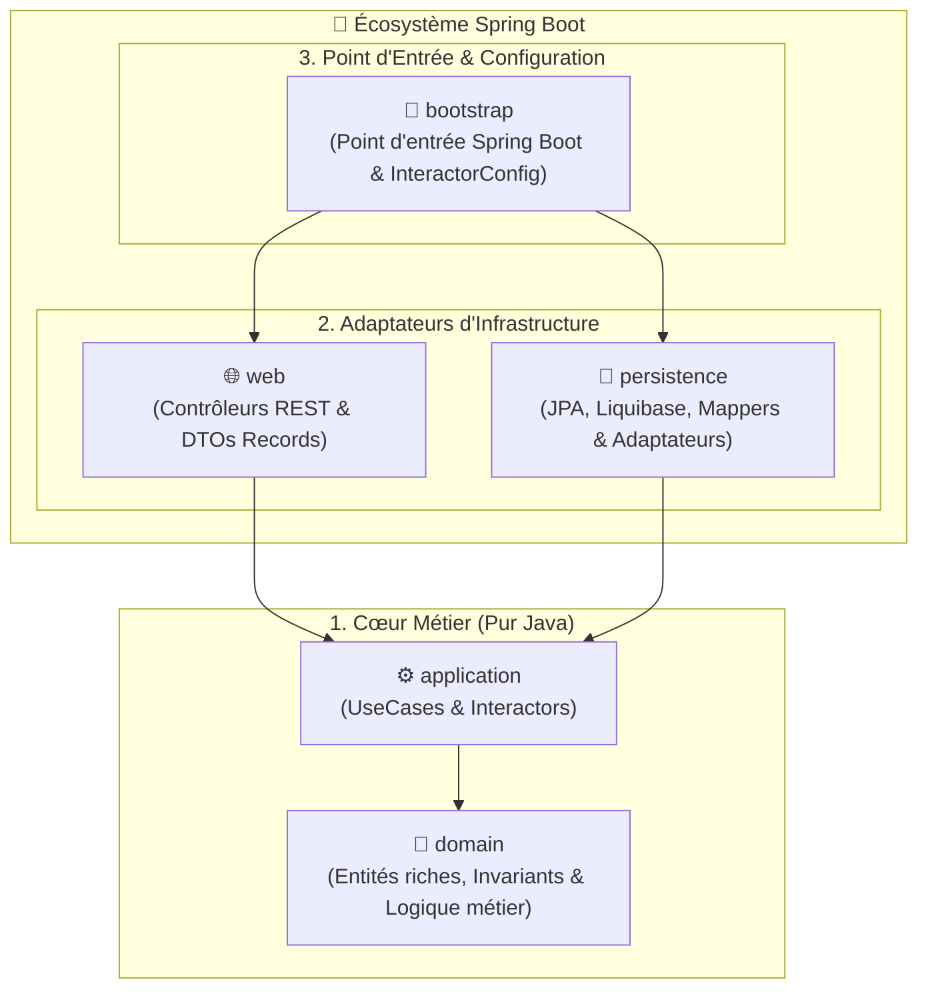

# 🏛️ Kera Starter

🇬🇧 **[English](./README.md)** | 🇫🇷 **Français**

[](https://openjdk.org/projects/jdk/25/)
[](https://spring.io/projects/spring-boot)
[](https://github.com/Felix-Page/Kera)

> **Modèle de projet de démarrage vierge pour la boîte à outils d'architecture [Kera](https://github.com/Felix-Page/Kera).**  
> *Démarrez instantanément un projet Java 25 & Spring Boot 4 en Clean Architecture stricte, sans aucune friction de plomberie.*

---

## 🎯 Présentation

**Kera Starter** est un patron de projet (*GitHub Template*) 100 % vierge de tout code métier, conçu pour éliminer l'intégralité du temps de configuration initial :

* **Zéro friction de plomberie** : Les 5 modules Maven, le BOM Kera, le compilateur Java 25, MapStruct et Liquibase sont pré-câblés.
* **Maven Wrapper inclus (`./mvnw`)** : Compilez et lancez l'application immédiatement sans nécessiter d'installation préalable de Maven.
* **Toile blanche métier** : Les modules `domain`, `application`, `persistence` et `web` sont entièrement vierges, prêts à accueillir votre propre organisation de packages sans code mort à nettoyer.
* **Skill Agentique IA embarqué** : Le dossier [`.agents/skills/kera/`](./.agents/skills/kera/) guide vos assistants IA (Cursor, Windsurf, Claude Code, Antigravity) pour générer du code respectant scrupuleusement les règles d'isolation de Kera.

---

## 🚀 Démarrage Rapide

### Prérequis

* **Java** : 25 (ex: Eclipse Temurin via `mise` ou `sdkman`)
* Le **Maven Wrapper (`./mvnw`)** est déjà inclus dans le dépôt.

> [!NOTE]
> Assurez-vous que [Kera v0.1.0](https://github.com/Felix-Page/Kera/releases/tag/v0.1.0) est installé dans votre cache Maven local (`git clone --branch v0.1.0 https://github.com/Felix-Page/Kera.git && cd Kera && mvn clean install`).

### 1. Utiliser ce modèle ou cloner

Cliquez sur le bouton vert **"Use this template"** sur GitHub, ou clonez le dépôt :

```bash
git clone https://github.com/Felix-Page/kera-starter.git mon-projet
cd mon-projet
```

### 2. Configurer votre base de données

Ajustez vos identifiants et l'URL JDBC de votre base dans `bootstrap/src/main/resources/application.yml` (PostgreSQL, MariaDB, MySQL, H2...).

### 3. Compiler et Lancer

```bash
./mvnw clean package -DskipTests
java -jar bootstrap/target/bootstrap-0.1.0-SNAPSHOT.jar
```

L'application démarre immédiatement sur `http://localhost:8080`.

---

## 🛠️ Comment créer votre première fonctionnalité

### Option A : Développement Manuel Pas-à-Pas

Pour ajouter une nouvelle entité métier (exemple : `Order`) :

1. **Domaine (`domain`)** :
   * Créez votre modèle pur Java dans `com.example.app.domain.Order` (héritant de `VersionedDomain<UUID>`).
   * Validez vos invariants métier dans les constructeurs et setters.
2. **Cas d'usage (`application`)** :
   * Déclarez votre interface `CreateOrderUseCase` et implémentez-la dans `CreateOrderInteractor`.
   * Injectez `GenericPort<UUID, Order>` pour la persistance standard.
3. **Persistance (`persistence`)** :
   * Créez l'entité JPA `OrderEntity` (implémentant les contrats Kera comme `VersionedEntity<UUID>` ou `IdentifiableEntity<UUID>`).
   * Créez l'interface `OrderJpaRepository extends JpaRepository<OrderEntity, UUID>`.
   * Créez le mapper MapStruct `OrderEntityMapper extends AbstractEntityMapper<Order, OrderEntity>`.
   * Créez l'adaptateur `OrderPersistenceAdapter extends GenericPortImpl<UUID, Order, OrderEntity, OrderJpaRepository, OrderEntityMapper>`.
   * Ajoutez le changeset SQL Liquibase dans `src/main/resources/db/changelog/`.
4. **Couche Web (`web`)** :
   * Créez vos records DTO (`CreateOrderRequest`, `OrderResponse`).
   * Créez votre `OrderController` avec validation `@Valid`.
5. **Câblage IoC (`bootstrap`)** :
   * Déclarez le `@Bean` de votre interactor dans `com.example.app.config.InteractorConfig`.

---

### Option B : Assisté par IA

Ouvrez le projet dans votre IDE compatible avec les agents IA (Cursor, Windsurf, Claude Code, Google Antigravity). Le skill d'architecture Kera est automatiquement détecté. 

Il vous suffit de formuler votre besoin dans le chat :
> *"Crée un agrégat Order avec les champs customerId et items, son UseCase de création, l'adaptateur de persistance et l'endpoint REST correspondant."*

L'assistant appliquera immédiatement les règles de découplage et implémentera les 5 couches sans violer l'isolation du domaine.

---

## 🏗️ Architecture Multi-Modules en Miroir

Le projet suit la symétrie multi-modules standardisée par Kera :



| Module | Rôle | Dépendances |
| :--- | :--- | :--- |
| **`domain`** | Entités pures, Invariants métier, Value Objects. | **Aucune** (JDK 25 pur) |
| **`application`** | Cas d'utilisation (`*UseCase`) et interactors (`*Interactor`). | `domain`, `kera-application` |
| **`persistence`** | Entités JPA, Mappers MapStruct, Adaptateurs `GenericPortImpl`. | `domain`, `kera-spring-persistence` |
| **`web`** | Contrôleurs REST, DTOs `record`, Mappers Web. | `domain`, `application`, `kera-spring-web` |
| **`bootstrap`** | `Bootstrap.java` (`@SpringBootApplication`), câblage IoC (`InteractorConfig`). | Tous les modules, `kera-spring-bootstrap` |

---

## 📄 Licence

Ce modèle de démarrage est mis à disposition librement. Vous êtes totalement libre de choisir la licence de votre convenance (propriétaire, MIT, Apache, GPL...) pour votre propre application.

---

## 🔗 Liens Utiles

* 🏛️ **Dépôt de la boîte à outils Kera** : [github.com/Felix-Page/Kera](https://github.com/Felix-Page/Kera)
* 💡 **Application de démonstration** : [github.com/Felix-Page/kera-demo](https://github.com/Felix-Page/kera-demo)
* 👤 **Auteur** : [Félix Page](https://github.com/Felix-Page)
