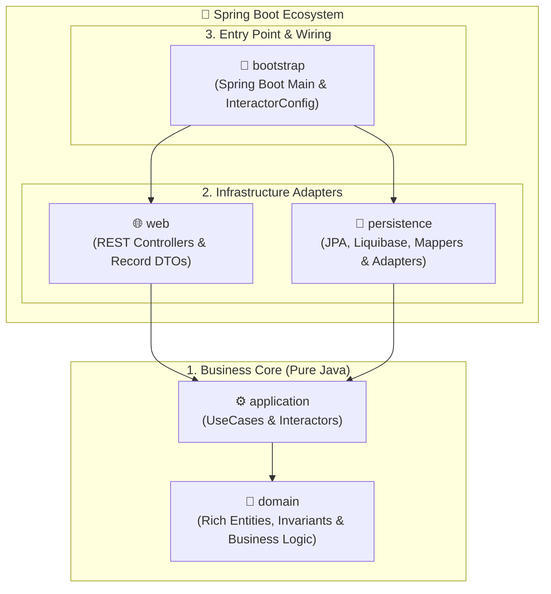

# 🏛️ Kera Starter

🇬🇧 **English** | 🇫🇷 **[Français](./README.fr.md)**

[](https://openjdk.org/projects/jdk/25/)
[](https://spring.io/projects/spring-boot)
[](https://github.com/Felix-Page/Kera)

> **Blank starter template for the [Kera](https://github.com/Felix-Page/Kera) architectural toolkit.**  
> *Instantly start building strict Clean Architecture applications in Java 25 & Spring Boot 4 without plumbing friction.*

---

## 🎯 Overview

**Kera Starter** is a 100% blank starter template (*GitHub Template*) designed to eliminate setup overhead when starting a new service:

* **Zero plumbing friction**: 5-module Maven structure, Kera BOM, Java 25 compiler, MapStruct, and Liquibase migrations pre-configured.
* **Maven Wrapper included (`./mvnw`)**: Build and run immediately out of the box without requiring local Maven installation.
* **Blank canvas**: The `domain`, `application`, `persistence`, and `web` modules are completely blank, ready for your own package organization without boilerplate cleanup.
* **Embedded AI Agent Skill**: Pre-configured [`.agents/skills/kera/`](./.agents/skills/kera/) directory providing guidelines and reference architecture to AI coding assistants (Cursor, Windsurf, Claude Code, Antigravity).

---

## 🚀 Quickstart

### Prerequisites

* **Java**: 25 (e.g., Eclipse Temurin via `mise` or `sdkman`)
* The **Maven Wrapper (`./mvnw`)** is already included in the repository.

> [!NOTE]
> Make sure [Kera v0.1.0](https://github.com/Felix-Page/Kera/releases/tag/v0.1.0) is installed in your local Maven cache (`git clone --branch v0.1.0 https://github.com/Felix-Page/Kera.git && cd Kera && mvn clean install`).

### 1. Use this template or clone

Click the green **"Use this template"** button on GitHub, or clone the repository:

```bash
git clone https://github.com/Felix-Page/kera-starter.git my-project
cd my-project
```

### 2. Configure your database

Adjust your JDBC connection settings and credentials in `bootstrap/src/main/resources/application.yml` (PostgreSQL, MariaDB, MySQL, H2...).

### 3. Build and Run

```bash
./mvnw clean package -DskipTests
java -jar bootstrap/target/bootstrap-0.1.0-SNAPSHOT.jar
```

The application starts immediately on `http://localhost:8080`.

---

## 🛠️ How to build your first feature

### Option A: Manual Step-by-Step Development

To add a new business entity (e.g. `Order`):

1. **Domain (`domain`)**:
   * Create your pure Java model in `com.example.app.domain.Order` (extending `VersionedDomain<UUID>`).
   * Validate business invariants in constructors and setters.
2. **Use cases (`application`)**:
   * Declare the `CreateOrderUseCase` interface and implement `CreateOrderInteractor`.
   * Inject `GenericPort<UUID, Order>` for standard CRUD operations.
3. **Persistence (`persistence`)**:
   * Create the JPA entity `OrderEntity` (implementing Kera contracts such as `VersionedEntity<UUID>` or `IdentifiableEntity<UUID>`).
   * Create the repository `OrderJpaRepository extends JpaRepository<OrderEntity, UUID>`.
   * Create the MapStruct mapper `OrderEntityMapper extends AbstractEntityMapper<Order, OrderEntity>`.
   * Create the adapter `OrderPersistenceAdapter extends GenericPortImpl<UUID, Order, OrderEntity, OrderJpaRepository, OrderEntityMapper>`.
   * Add the Liquibase SQL changeset in `src/main/resources/db/changelog/`.
4. **Web layer (`web`)**:
   * Create DTO records (`CreateOrderRequest`, `OrderResponse`).
   * Create the controller `OrderController` with `@Valid` input validation.
5. **IoC Wiring (`bootstrap`)**:
   * Declare the interactor `@Bean` in `com.example.app.config.InteractorConfig`.

---

### Option B: AI-Assisted

Open the project in an AI-capable editor (Cursor, Windsurf, Claude Code, Google Antigravity). The Kera architecture skill is automatically loaded.

Simply prompt the assistant:
> *"Create an Order aggregate with customerId and items, its creation UseCase, persistence adapter, and REST endpoint."*

The assistant will adhere to Kera's isolation rules and generate code across the 5 modules cleanly.

---

## 🏗️ Multi-Module Architecture

The project adheres to Kera's symmetrical multi-module structure:



| Module | Role | Dependencies |
| :--- | :--- | :--- |
| **`domain`** | Pure models, Domain invariants, Value objects. | **None** (Pure JDK 25) |
| **`application`** | Use cases (`*UseCase`) and interactors (`*Interactor`). | `domain`, `kera-application` |
| **`persistence`** | JPA entities, MapStruct mappers, `GenericPortImpl` adapters. | `domain`, `kera-spring-persistence` |
| **`web`** | REST controllers, `record` DTOs, Web mappers. | `domain`, `application`, `kera-spring-web` |
| **`bootstrap`** | `Bootstrap.java` (`@SpringBootApplication`), IoC configuration (`InteractorConfig`). | All modules, `kera-spring-bootstrap` |

---

## 📄 License

This starter template is provided freely. You are entirely free to choose any license (proprietary, MIT, Apache, GPL, etc.) for your own application.

---

## 🔗 Useful Links

* 🏛️ **Kera Architectural Toolkit**: [github.com/Felix-Page/Kera](https://github.com/Felix-Page/Kera)
* 💡 **Demonstration Showcase**: [github.com/Felix-Page/kera-demo](https://github.com/Felix-Page/kera-demo)
* 👤 **Author**: [Félix Page](https://github.com/Felix-Page)
